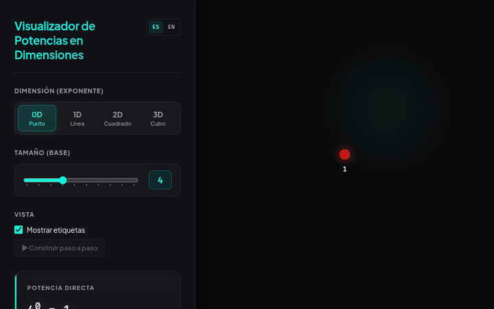
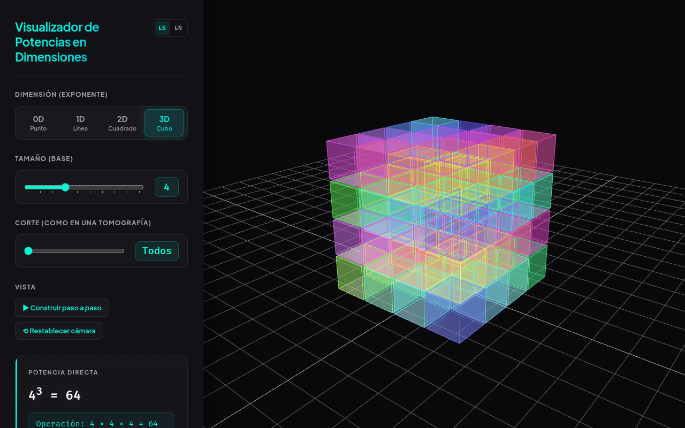

# Exponent Dimensions — Visualizador de Potencias en Dimensiones

Visualizador geométrico interactivo de potencias y raíces. Muestra cómo el **exponente crea dimensiones** (punto → línea → cuadrado → cubo) y cómo la **raíz las reduce**, de vuelta al tamaño de un lado.

**Demo:** [exponent-dimensions.rovisoft.net](https://exponent-dimensions.rovisoft.net/)



## Descripción

Cada vez que se multiplica por la base se añade una dimensión: la figura anterior se copia *B* veces en una dirección nueva. La línea es el punto repetido, el cuadrado es la línea apilada hacia arriba y el cubo es el cuadrado apilado en profundidad. La raíz recorre el camino inverso: a partir del total (área, volumen, píxeles o vóxeles) recupera cuánto mide un lado.

La app incluye ejemplos reales de esta idea: tomografías y resonancias (un volumen 3D formado por cortes 2D), impresión 3D por capas, píxeles de pantallas, litros y centímetros cúbicos, y la ley del cuadrado-cubo.



## Funcionalidades

- **0D (Punto):** `B⁰ = 1`, un único punto sin importar la base. Explica por qué la raíz de índice 0 no está definida.
- **1D (Línea):** la base como segmentos unitarios de colores sobre una recta numérica.
- **2D (Cuadrado):** cuadrícula de base × base con ejes y coordenadas `(x, y)` en cada celda.
- **3D (Cubo):** base × base × base cubos unitarios semitransparentes, con rotación y zoom.
- **Corte (como en una tomografía):** en 3D muestra una sola capa del cubo, es decir, reduce el cubo a un cuadrado 2D.
- **Construir paso a paso:** anima cómo cada dimensión se forma copiando la anterior.
- **Panel matemático:** potencia, desglose de la multiplicación y operación inversa con exponente fraccionario.
- **Colores coherentes entre dimensiones:** la línea 1D es la fila inferior de la cuadrícula 2D, y la cuadrícula 2D es la primera capa del cubo.
- **Enlaces compartibles:** el estado se guarda en la URL, por ejemplo [`#b=4&e=3&lang=es`](https://exponent-dimensions.rovisoft.net/#b=4&e=3&lang=es).
- **Enlace a [exponent-plot](https://exponent-plot.rovisoft.net/):** el visualizador hermano de exponentes positivos y negativos (base 0–4, exponente −4…4) abre la misma potencia y el mismo idioma. Si la base pasa de 4 se muestra con base 4 y el enlace lo avisa.
- **Español e inglés**, con detección automática del idioma del navegador.
- **Accesible:** navegación con teclado, foco visible, descripciones para lectores de pantalla y respeto a `prefers-reduced-motion`.
- **Diseño responsivo:** en móviles y pantallas bajas usa un layout vertical con botón para volver a los controles.

## Estructura del proyecto

```
exponent-dimensions/
├── .github/
│   ├── workflows/
│   │   ├── ci.yml                       # actionlint, HTML, JS, unitarias, versión, humo y Lighthouse
│   │   ├── release.yml                  # Release al publicar un tag vX.Y.Z firmado
│   │   └── post-release-validation.yml  # Producción sirve el tag y pasa la prueba de humo
│   ├── dependabot.yml
│   └── trusted-signers                  # Llaves que pueden firmar tags
├── AGENTS.md                 # Convenciones y proceso de release
├── CHANGELOG.md
├── Makefile                  # serve, lint, unit, smoke, lighthouse, check
├── docs/                     # Imágenes del README (no se publican)
├── tests/
│   ├── assets.test.mjs       # Cada recurso e import local lleva ?v=VERSION
│   ├── plot-link.test.mjs    # Mapeo del enlace hacia exponent-plot
│   └── smoke.mjs             # Prueba de humo en Chrome headless
└── src/                      # Sitio estático publicado
    ├── index.html            # Estructura, metadatos e import map de Three.js
    ├── styles.css
    ├── app.js                # Estado, controles, dibujo 0D–2D y animaciones
    ├── scene3d.js            # Escena 3D (se carga solo al abrir la vista 3D)
    ├── i18n.js               # Textos en español e inglés
    ├── plot-link.js          # Enlace hacia exponent-plot (mismo formato de hash)
    ├── favicon.svg / favicon.png / apple-touch-icon.png
    └── og-image.png          # Vista previa para redes sociales (1200×630)
```

No hay paso de compilación. Three.js 0.187 se carga como módulo ES desde jsDelivr, con hashes de integridad (SRI) en el import map.

## Uso local

Los módulos ES no funcionan abriendo el archivo con `file://`, así que hay que servir `src/` con cualquier servidor estático:

```bash
make serve        # o: python3 -m http.server 8000 --directory src
```

Luego visita `http://localhost:8000`.

Para validar lo mismo que el CI (HTML, sintaxis JS, pruebas unitarias y una prueba de humo en Chrome headless):

```bash
make check        # CHROME_PATH=/ruta/a/chrome si no lo encuentra solo
```

## Despliegue y versiones

Cloudflare Pages publica `src/` automáticamente: cada push a `main` va a producción y cada PR genera una vista previa.

Las versiones siguen [SemVer](https://semver.org/lang/es/) y se anotan en [CHANGELOG.md](CHANGELOG.md). Un tag `vX.Y.Z` firmado sobre `main` crea la [GitHub Release](https://github.com/airvzxf/exponent-dimensions/releases) con el zip de `src/` y, después, un workflow comprueba que producción sirve exactamente esos archivos. El proceso completo está en [AGENTS.md](AGENTS.md).

### Versiones

Producción guarda JS y CSS en la caché del navegador durante un año (`max-age=31536000`), mientras que el HTML no se guarda (`max-age=0`). Para que un visitante nunca combine el HTML nuevo con un script viejo, cada recurso local lleva la versión en la URL:

- `styles.css?v=X.Y.Z` y `app.js?v=X.Y.Z` en `src/index.html`;
- los `import` relativos entre módulos (`./i18n.js?v=X.Y.Z`, `./plot-link.js?v=X.Y.Z`, `./scene3d.js?v=X.Y.Z`).

Cloudflare Pages ignora el query string al servir: solo cambia la clave de caché del navegador.

**La versión sube en el mismo PR que cambia JS o CSS de `src/`**, porque Pages publica en cuanto se fusiona y un PR de release posterior llegaría tarde. Ese PR es el de release y debe cambiar:

1. `VERSION` con `X.Y.Z`;
2. todos los `?v=` de `src/` (`grep -rn '?v=' src/`);
3. la sección `## [X.Y.Z] - AAAA-MM-DD` del CHANGELOG, con su enlace de comparación al pie.

Después del merge se crea el tag firmado `vX.Y.Z` sobre el commit del merge en `main`. Los PRs que no tocan JS ni CSS de `src/` (documentación, CI, pruebas, Dependabot de herramientas) no necesitan versión nueva.

Dos comprobaciones lo vigilan: `make unit` falla si algún recurso o import local no lleva `?v=` igual a `VERSION`, y el job **Asset version bumped** del CI falla en un PR que cambia `src/*.js` o `src/*.css` sin subir `VERSION`.

## Tecnologías

- **HTML5 Canvas 2D:** vistas 0D, 1D y 2D, con soporte para pantallas de alta densidad.
- **Three.js 0.187 (WebGL):** vista 3D con `InstancedMesh` (2 llamadas de dibujo para hasta 1000 cubos).
- **OrbitControls:** rotación y zoom de la escena 3D.
- **Google Fonts:** Fira Code y Plus Jakarta Sans.

## Licencia

Copyright (C) 2026 Israel Alberto Roldan Vega. Este proyecto está licenciado bajo la [GNU Affero General Public License v3.0](LICENSE).
